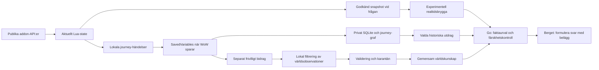

# Wisp: aktuell världskunskap och privat karaktärsminne

Beslut och genomförandeplan, 6 november 2026. Egen produktlogik i Lua och Go, PostgreSQL på VM:n, SQLite hos spelaren. Inga stora insamlings- eller agentramverk.

## Beslutet

Tre olika datamängder ska ha olika livscykler:

1. **Nu:** addonen håller aktuellt karaktärsstate i Lua-minnet. Vid en godkänd AI-fråga läser den state igen och bifogar en liten tidsstämplad snapshot. Detta får företräde framför äldre uppgifter för samma fält.
2. **Min resa:** addonen skapar stabilt identifierade händelser och ett daterat checkpoint i SavedVariables. När WoW faktiskt sparar kan desktopklienten importera dem till lokal SQLite och bygga om den lokala journey-grafen. Ingen inloggning hos Wisp behövs.
3. **Spelvärlden:** gemensamma, källmärkta fakta från tillåtna API:er och eventuella frivilliga observationer. Spelarens journal ska aldrig bli central världsdata genom att vi laddar upp den i sin helhet.

SavedVariables är ingen livefil. `/reload`, utloggning och normal avslutning kan få WoW att spara; en krasch kan förlora den osparade delen. Vi ska inte kräva reload för varje chattfråga. Importören kan inte läsa det som ännu bara finns i Lua-minnet. Realtidsbryggan och bakgrundsimporten är separata problem.

## Karaktärens state och journey

`apps/addon/Wisp/State.lua` läser level, XP, område, klass/ras-ID, aktiva quests med mål/räknare, utrustade item-ID:n, professioner och död/levande-status när klientens publika API stöder dem. Tillgänglighetsflaggor skiljer ett otillgängligt API från en bekräftat tom lista. Lägg bara till fler fält när de ger en tydlig spelarupplevelse.

Vi sparar betydelsefulla förändringar: accepterad quest, ändrat questframsteg, quest som lämnat loggen, inlämning, utrustningsbyte och död/återuppståndelse. Befintlig journal står för session, områdesbyte och level-up. Att en quest försvinner bevisar inte att den övergivits. Befintliga quests vid start får vara baseline; vi ska inte hitta på gamla accepteringsdatum.

Täta uppdateringar slås ihop under en kort debounce. Samma framsteg får inte skapa en ny händelse bara för att `QUEST_LOG_UPDATE` upprepas. Händelser har monotona ID:n per installation/karaktär. Snapshot/checkpoint har observationstid och revision. Lokal återimport är idempotent; äldre checkpoint får inte skriva över nyare.

Journalens inspelning och AI-kontext är olika samtycken. Pausad inspelning stoppar bestående nya checkpoints och händelser. En användare kan ändå uttryckligen välja en aktuell observation till en fråga. Tidigare sparad data försvinner inte av en paus. Den ska kunna exporteras/raderas separat.

Nuvarande addon har en begränsad ringbuffert på 2000 händelser. Sparade droppräknare ska redovisa luckor. Det är inte en garanti om oändlig historik inne i WoW; SQLite behåller redan importerad historik. Mät faktisk tillväxt innan bufferten utökas.

## Så får AI:n rätt nuläge

Vid Enter byggs ett nytt meddelande med:

- frågan och ett unikt request-ID;
- tidsstämplad level, zon, build och klass/ras-ID;
- högst fyra valda aktiva quests med begränsade målräknare;
- utrustade item-ID:n och professionernas ID/rank när de är tillgängliga;
- tydliga `truncated` och `missing` när överföringsbudgeten eller ett API begränsar underlaget.

Snapshot tas om vid skicket; ett gammalt desktop-checkpoint får inte automatiskt märkas om till live. I den experimentella kanalen väljer spelaren att inkludera aktuellt karaktärsstate för just frågan. Senare kan ett separat, återkalleligt karaktärsval göra det till standard, med en synlig kontextindikator och möjlighet att granska/utesluta uppgifter.

Go validerar identitet lokalt, format, storlek och färskhet före AI-anropet. Nuvarande gräns är 90 sekunder med liten klocktolerans; svaret måste uttrycka observationstid, inte lova en kontinuerlig livefeed. Färska level 16-fakta går före en historisk level 15-journal. Utrustade ID:n bevisar inte itemnamn eller stats: de kräver matchande världsfakta. Saknade fält är okända. Namn, GUID, kontonamn, filer, bilder och hela journalen behöver inte skickas till Berget.

OCR-bryggan är fortfarande experimentell. Checksummor, request/GUID-bindning, single-flight, synlig väntestatus och ingen automatisk betald återsändning krävs. Den nya panelens fulla E2E ska verifieras innan den kallas färdig. Insamling av journalen får inte bero på att chattransporten lyckas.

## Frivilliga världsobservationer

Detta är en **plan**, inte aktiverad insamling från befintliga användare. En separat inställning ska förklara exakt vilka strukturerade fakta som delas. Den ska vara av från början och gå att stänga av utan att förlora den privata journalen eller AI-chatten.

Börja smalt med tre faktatyper:

| Typ | Skicka | Dra inte slutsatsen |
|---|---|---|
| Questinteraktion | quest-ID, accepterad/inlämnad, NPC/object-ID om faktiskt observerat, build och kartposition för målet | Att en annan nyligen gjord quest är ett krav |
| NPC/vendor | NPC-ID, tjänst, målposition, observerat erbjudet item och pris/valuta | Att frånvaro i en observation betyder borttagen NPC eller vara |
| Recept/tränare | spell/recipe-ID, skillkrav, faktisk lärokälla och pris, build | Att en visad men låst förmåga är tillgänglig för alla |

Nästa fas kan innehålla loot och resvägar. Lootobservationer får inte bli dropchans utan tillförlitlig nämnare, komplett registrering, lootregler och osäkerhetsintervall. Playerns gångväg och kompletta rörelsetidsserie ska inte centraliseras för att bygga ett reseförslag.

Varje observation ska normaliseras lokalt med en fast allowlist. Inga chattmeddelanden, fria anteckningar, karaktärsnamn, GUID:n, konto-/realmnamn, grupper/guilds, andra spelares namn, systemfiler eller skärmbilder. NPC-/objekt-ID ska vara spelvärldens template-ID, inte ett sessions- eller spawn-GUID. Skicka målets grova kartposition, inte spelarens tidsstämplade resa.

Aggreggera samma sak lokalt per build och dygn, exempelvis en observation per quest/NPC/relation. Runda tid till dag och koordinat till lämplig kartcell. Exakt avrundning beror på faktatyp och nyttan; rare events och tidsbegränsade positioner kräver extra försiktighet. Falsk precision är inte bättre data.

### Integritet och missbruksbegränsning

Vi ska kalla råa bidrag **minimerade/pseudonymiserade observationer**, inte garantera anonymitet. Hashade GUID:n är inte automatiskt anonyma. IP-adress, bidrags-token och sällsynta kombinationer kan fortfarande knyta data till en person. Detta följer distinktionen i [EDPB:s vägledning](https://www.edpb.europa.eu/topics/ai-and-technology/anonymisation-pseudonymisation_en) och [EU-kommissionens beskrivning](https://commission.europa.eu/law/law-topic/data-protection/information-business-and-organisations/application-gdpr_en).

Förslag: ett separat slumpmässigt bidrags-ID/nyckelpar som aldrig återanvänder char-ID; rullande, tidsbegränsade kvitton för deduplicering och radering. Det ger ingen bevisad unik människa. Ingen kontoinloggning krävs, men avsaknad av konton löser inte Sybil-problemet. Högst en vikt per installation/faktum/dag, hastighetsgränser och granskning av extrema bidrag. Ska hårdare identitet krävas, måste integritetsmodellen omprövas.

Håll kortlivad dedupliceringsdata separerad från världsaggregat. Första föreslagna retention: bidragsbatcher 7 dygn, kvitton upp till 30 dygn, nätverksloggar högst 24 timmar och inga IP-adresser i produktens faktagraf. Faktiska proxy-/backupinställningar måste granskas före aktivering. Raderingshandtag låter spelaren radera ännu länkbara bidrag; efter irreversibel aggregering går ett individspecifikt uttag inte att lova. Beskriv det före samtycke.

Publicera inte råa bidrag. Ett startvillkor som minst fem olika bidragsinstallationer och flera tillfällen kan hjälpa faktagranskning, men är **varken anonymitetsbevis eller garanti mot fusk**. Välj undertryckning, grövre aggregering och vid behov formell integritetsanalys för sällsynta kombinationer. Blanda inte anonyma aggregat med återidentifierbara journaler eller AI-loggar.

## Källor och deras roller

| Källa | Prioritet och roll | Gräns |
|---|---|---|
| ForeverDB:s godkända API | Bred Forever-bas och spelarobservationer med härkomst; detaljdata där API:t har det | Behåll deras Classic/client/observation-märkningar. Synlig länk när fakta används. Det är inte oberoende verifiering av varje speluppgift. |
| Blizzards officiella API | Versionsmärkta ID:n, metadata och de fält som faktiskt svarar i rätt namespace | Ingen slutsats om komplett Forever-täckning. Daterad profil är ingen realtidskälla. |
| Officiella ändringsnotiser | Upptäcka vilka områden som behöver kontrolleras igen | En notis är inte automatiskt en maskinläsbar, komplett faktadiff. Länka och sammanfatta med rättigheter i behåll. |
| Frivilliga Wisp-observationer | Bekräfta verkliga interaktioner och hitta konflikter/luckor | Låg tillit innan validering. En användare räcker inte för en allmän slutsats. |
| Egen redaktionell data | Begripliga nybörjarvägar, lore-sammanhang, vackra zoner och förklaringar | Subjektiva upplevelser märks som omdömen. Skriv eget material och belägg sakuppgifter. |
| Andra communitydatabaser | Komplettering först när spelversion och återanvändning är klarlagda | Ingen generell bulkimport av Wowhead, QuestieDB, 60.tools eller andra sidor på grund av gratis åtkomst eller en kodlicens. |

ForeverDB:s API redovisar både klientdata och observationer/fallbacks. Det är därför den snabbaste befintliga vägen till bred täckning, kompletterad av officiella källor och senare våra egna godkända observationer. [API-dokumentation och villkor](https://foreverdb.net/developers).

[Blizzards API-villkor](https://www.blizzard.com/en-us/legal/a2989b50-5f16-43b1-abec-2ae17cc09dd6/blizzard-developer-api-terms-of-use) innehåller krav på källangivelse, privatliv, retention och begränsningar för datautvinning. Vår slutsats är att API-åtkomst inte i sig godkänner en separat crowdsourcing-/extraktionslösning. Klarlägg den insamlingens tillåtlighet innan extern lansering; användarens samtycke ersätter inte spel-/API-villkor. Detta är ett öppet införandekrav, inte ett påstående att alla vanliga addonobservationer är förbjudna.

## Gemensam faktamodell

Spara påståenden separat från entitetens identitet:

`subject → predicate → object/value`, med `game_variant`, `client_build`, `region_scope`, `source`, `source_revision`, `observed_day`, `fetched_at`, `expires_at`, `verification_status`, fältets ursprung och ändringshistorik.

En quest kan ha ett bekräftat NPC-namn men en Classic-position. Ett generellt `verified=true` på hela noden räcker inte. Klassisk reservdata, konverterade koordinater, egna observationer och officiell bekräftelse får inte skrivas över till samma obestämda sanning.

Inför föreslagna statusar: `reported`, `corroborated`, `source_confirmed`, `conflicting`, `stale`, `withdrawn`. Både källor och påståenden ska kunna dras tillbaka. Ett stort antal kopior av samma underliggande källa räknas inte som oberoende bekräftelser. Nuvarande importer har ännu grövre entitets-/källmärkning; denna påståendenivå är nästa datamodellsteg.

## Uppdatering och drift

Nu finns separata, resursbegränsade VM-jobb för Blizzard och ForeverDB. ForeverDB kör timvis minut 7, högst 200 anrop per batch, cirka ett anrop per 1,1 sekund, egen låsning och en beständig säkerhetsbudget på 8000/dygn. Jobbet fortsätter från sin kö. Ett 429 följer Retry-After; upprepade leverantörsfel pausar. Inga extra nycklar eller parallella importer för att gå runt gränser.

| Arbete | Plan |
|---|---|
| Upptäcka ny build och katalogändringar | Vid varje tillåten batch kontrollera build; bygg ny versionsavgränsad projektion och jämför |
| Katalog, klasser och professioner | Mål 24 timmar; faktisk ålder visas när kön eller upstream fördröjer |
| Questdetaljer | Mål 7 dygn, prioriterade använda/ändrade quests tidigare |
| Stor item/spell-detaljsvans | Mål 21 dygn inom kvoten; inte lova daglig refresh av 60 000 detaljsidor |
| Expiry/purge | 28 dygn för nuvarande API-lager; filtrera ut utgångna fakta även om importen stannat |
| Frivilliga observationer | Lokalt först, skicka små godkända batcher när nya sparade data finns; ingen reload för insamlingens skull |
| Konflikter | Karantän och omhämtning av berörda fakta; dra tillbaka riskfyllda rekommendationer tills konflikten är löst |
| Sökindex | PostgreSQL-index uppdateras transaktionellt med fakta; ingen separat stor sökserver i detta skede |

Nästa driftsteg är ändringsstyrd prioritering av använda quest-/item-ID:n, med ett explicit tak så gamla populära objekt inte svälter resten av kön. Använd i första hand leverantörens build-/ändringsendpoints och HTTP-validering om dokumenterat stöd finns. Lova inte deltaimport när leverantören bara har fulla sidor.

Byt aldrig till en ny build och kalla den komplett efter första metaanropet. Nytt buildmaterial ska ha synlig partiell status och en befordringsregel för kritiska kategorier. Förvara gammal build som historiskt underlag inom respektive retention; den får inte maskeras som aktuell.

## Mått och leveransordning

Mät kategorierna quests, föremål/gear, NPC:er, zoner, klasser/förmågor/talanger, professioner/recept, instanser/bossar, resor, lore och upplevelser var för sig. För varje kategori: källans kända antal, unika listade ID:n, hämtade detaljsidor, användbara fält, ålder, konflikter och kunskapsluckor. Härledda questvägar och gearkombinationer är funktioner som måste utvärderas; de uppstår inte bara för att raderna finns.

- [x] Godkänd ForeverDB-import, versions-/ursprungsmärkning och indexering.
- [x] Begränsad schemalagd VM-uppdatering och täckningsrapport, med synliga kvarvarande jobb.
- [ ] Slutföra initial katalog och detaljbacklog när upstream tillåter; inget påstående om all WoW-kunskap.
- [ ] Verifiera rik lokal state → SavedVariables → idempotent SQLite/journey.
- [ ] Verifiera frågeögonblickets snapshot, aktuell level och mål mot äldre lokal historik.
- [ ] Slutföra nya Lua-panelens verkliga AI-E2E och återanvändbara returväg.
- [ ] Implementera påståendenivå, konfliktkarantän och ändringsstyrd kö.
- [ ] Klarlägga extern observationsinsamling och implementera separat opt-in, lokal allowlist, raderingskvitton och loggretention.
- [ ] Pilot med quest/NPC-interaktioner; testa felaktiga bidrag, bortkoppling, återimport och avstängt samtycke.

Sökprestanda rapporteras separat från OCR, nätverk och modell. Den första mätningen under aktiv import gav 94–98 ms median för två questfrågor efter optimering; detta är inget generellt SLA. Målet är låg p95 även när korpusen växer. Säkerställ rätt fakta och kontrollerad kostnad före fler tjänster eller vektorindex.
