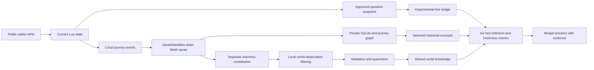

# Jornia current world knowledge and private character memory

Decision and implementation plan, 6 November 2026. First-party Lua and Go product logic, PostgreSQL on the VM and SQLite on the player's machine. No large collection or agent frameworks.

## Decision

Three datasets have separate lifecycles:

1. **Now:** the addon maintains current character state in Lua memory. For an approved AI question, it refreshes state and attaches a small dated snapshot. Those fields take precedence over older observations.
2. **My journey:** the addon creates stable event IDs and a dated checkpoint in SavedVariables. Once WoW actually saves, the desktop client can import them into local SQLite and rebuild its journey graph. No Jornia login is required.
3. **The world:** shared, sourced facts from permitted APIs and potentially voluntary observations. Never turn the player's entire uploaded journal into central world data.

SavedVariables is not a live file. Reload, logout and normal exit can make WoW save; crashes can lose unsaved data. Do not require reload for every question. The importer cannot read data still present only in Lua memory. The live bridge and background import are separate problems.

## Character state and journey

`apps/addon/Jornia/State.lua` reads level, XP, area, class/race IDs, active quests/objectives/counters, equipped item IDs, professions and death/alive status where supported by public client APIs. Availability flags distinguish unsupported APIs from confirmed empty lists. Add fields only when they improve the player experience.

Persist meaningful changes: quest acceptance, progress, departure from the log, turn-in, equipment changes and death/resurrection. The existing journal handles sessions, area changes and level-ups. A disappearing quest does not prove abandonment. Existing quests at startup form a baseline; do not invent acceptance dates.

A short debounce coalesces frequent updates. Repeated `QUEST_LOG_UPDATE` events must not duplicate unchanged progress. Events have monotonic IDs per installation/character. Snapshots/checkpoints have observation times and revisions. Local reimport is idempotent; older checkpoints cannot overwrite newer ones.

Journal recording and AI context require separate choices. Pausing recording stops new persistent checkpoints/events. A user can still explicitly include a current observation in a question. Pausing does not delete earlier records; export/deletion remain separate.

The addon has a 2,000-event ring buffer. Persisted dropped-event counters must expose gaps. This does not guarantee unlimited in-game history; SQLite retains already imported history. Measure growth before enlarging the buffer.

## Giving AI the correct current state

Enter creates a new message containing:

- the question and unique request ID;
- dated level, zone, build and class/race IDs;
- at most four selected active quests with bounded objective counters;
- equipped item IDs and profession IDs/ranks where available;
- explicit `truncated` and `missing` markers when transport budgets or APIs limit context.

Refresh the snapshot at send time; never relabel an old desktop checkpoint as live. In the experimental channel the player chooses current state for each question. A later separate, revocable per-character preference could make this the default, with a visible context indicator and review/exclusion controls.

Go locally validates identity, shape, size and freshness before the AI call. The current age limit is 90 seconds with small clock tolerance. Answers must describe observation time, not promise a continuous live feed. Fresh level-16 facts override historical level-15 records. Item IDs alone do not establish names/stats; matching world evidence is needed. Missing fields are unknown. Names, GUIDs, account names, files, images and the whole journal need not reach Berget.

The OCR bridge remains experimental. Require checksums, request/GUID correlation, single-flight, visible pending states and no automatic paid replay. Verify the new panel's full E2E before calling it complete. Journal collection must not depend on successful chat transport.

## Voluntary world observations

This is a **plan**, not enabled collection from existing users. A separate setting must explain the precise structured facts shared. It starts off and can be disabled without losing the private journal or AI chat.

Begin with three fact types:

| Type | Send | Do not infer |
|---|---|---|
| Quest interaction | Quest ID, accepted/turned-in, actually observed NPC/object ID, build and target map position | That another recently completed quest is a prerequisite |
| NPC/vendor | NPC ID, service, target position, observed offered item and price/currency | That absence in one observation means the NPC/item was removed |
| Recipe/trainer | Spell/recipe ID, skill requirement, actual learning source and price, build | That a displayed but locked ability is available to everyone |

A later phase may include loot and routes. Loot observations must not become drop probabilities without a reliable denominator, complete recording, loot-rule context and uncertainty intervals. Do not centralize a player's complete timestamped movement history to produce travel advice.

Normalize each observation locally against a fixed allowlist. Exclude chat, free-text notes, character names, GUIDs, account/realm names, groups/guilds, other players' names, system files and screenshots. NPC/object IDs must be world template IDs rather than session/spawn GUIDs. Send coarse target positions, not the player's dated journey.

Aggregate repeated facts locally per build/day, for example one observation per quest/NPC/relation. Round time to day and coordinates to an appropriate map cell. Precision depends on usefulness and fact type; rare events/time-limited positions need extra care. False precision is not better data.

### Privacy and abuse controls

Call raw contributions **minimized/pseudonymized observations**, not guaranteed anonymous data. Hashed GUIDs are not automatically anonymous. IP addresses, contribution tokens and rare combinations can still identify a person. See [EDPB guidance](https://www.edpb.europa.eu/topics/ai-and-technology/anonymisation-pseudonymisation_en) and the [European Commission explanation](https://commission.europa.eu/law/law-topic/data-protection/information-business-and-organisations/application-gdpr_en).

Proposed design: a separate random contribution ID/key pair, never reusing character IDs; rolling, time-bounded deduplication/deletion receipts. This does not prove a unique human. Account-free does not solve Sybil attacks. Allow at most one weight per installation/fact/day, rate-limit and review extreme submissions. Stronger identity would require reassessing privacy.

Separate short-lived deduplication data from world aggregates. Initial proposed retention: contribution batches seven days, receipts up to 30 days, network logs at most 24 hours, and no IPs in the fact graph. Review actual proxy/backup settings before enabling collection. Deletion handles allow removal of still-linkable contributions; after irreversible aggregation, individual withdrawal cannot be promised. Explain this before consent.

Do not publish raw contributions. Requiring at least five distinct contributing installations and multiple occasions may aid review but is **neither anonymity proof nor fraud prevention**. Use suppression, coarser aggregation and formal privacy analysis where needed for rare combinations. Do not mix anonymous aggregates with reidentifiable journals or AI logs.

## Sources and roles

| Source | Priority and role | Limit |
|---|---|---|
| Approved ForeverDB API | Broad Forever baseline and sourced player observations; details where available | Preserve Classic/client/observation labels. Visible link when used. Not independent confirmation of every fact. |
| Official Blizzard API | Versioned IDs, metadata and fields available in the correct namespace | No complete-Forever claim. A dated profile is not live state. |
| Official change notes | Identify areas needing rechecking | Not automatically complete machine-readable diffs. Link/summarize while respecting rights. |
| Voluntary Jornia observations | Confirm actual interactions and find conflicts/gaps | Low trust before validation. One user does not establish a general conclusion. |
| Our editorial data | Beginner routes, lore context, beautiful zones and explanations | Label subjective experiences as opinions. Write original material and source factual claims. |
| Other community databases | Supplement after version/rights verification | No blanket bulk import from Wowhead, QuestieDB, 60.tools or others merely because access is free or code has a license. |

ForeverDB distinguishes client data, observations and fallbacks. It is therefore the fastest existing route to broad coverage, supplemented by official sources and later our own approved observations. [API documentation and terms](https://foreverdb.net/developers).

[Blizzard's API terms](https://www.blizzard.com/en-us/legal/a2989b50-5f16-43b1-abec-2ae17cc09dd6/blizzard-developer-api-terms-of-use) impose attribution, privacy, retention and data-extraction restrictions. API access does not itself authorize separate crowdsourcing/extraction. Clarify that collection before external launch; user consent does not replace game/API terms. This is an unresolved rollout requirement, not a claim that ordinary addon observations are all prohibited.

## Shared fact model

Store claims separately from entity identity:

`subject → predicate → object/value`, with `game_variant`, `client_build`, `region_scope`, `source`, `source_revision`, `observed_day`, `fetched_at`, `expires_at`, `verification_status`, field origin and change history.

A quest may have a confirmed NPC name and a Classic position. Node-wide `verified=true` is insufficient. Do not collapse Classic fallback, converted coordinates, our observations and official confirmation into one unspecified truth.

Proposed statuses: `reported`, `corroborated`, `source_confirmed`, `conflicting`, `stale`, `withdrawn`. Sources and claims must be retractable. Multiple copies of one underlying source are not independent corroboration. Current importers still label at coarser entity/source granularity; claim-level provenance is a future model step.

## Refresh and operations

Separate resource-limited VM jobs now handle Blizzard and ForeverDB. ForeverDB runs hourly at minute 7, at most 200 requests/batch, about one request per 1.1 seconds, with its own lock and persistent 8,000/day safety budget. It resumes its queue. HTTP 429 respects Retry-After; repeated provider failures pause work. Do not use extra keys or parallel importers to evade quotas.

| Work | Plan |
|---|---|
| New builds/catalog changes | Check build in each allowed batch; create a version-scoped projection and compare |
| Catalog/classes/professions | Target 24 hours; expose actual age when queue/upstream delays |
| Quest details | Target seven days, sooner for used/changed quests |
| Large item/spell detail backlog | Target 21 days within quota; no promise to refresh 60,000 detail pages daily |
| Expiry/purge | 28 days for current API storage; exclude expired facts even if import stalls |
| Voluntary observations | Local first, small approved batches when new saved data exists; no reload solely for collection |
| Conflicts | Quarantine and refetch affected claims; withdraw risky recommendations until resolved |
| Search indexes | PostgreSQL indexes update transactionally with facts; no separate large search service at this stage |

Next: change-driven priority for used quest/item IDs, explicitly capped so old popular records do not starve the queue. Prefer documented build/change endpoints and HTTP validation. Do not promise delta imports when a provider only supplies full pages.

Do not switch builds and call the new build complete after one metadata request. New-build material needs visible partial status and promotion rules for critical categories. Retain old builds as historical evidence only within applicable retention; never present them as current.

## Metrics and delivery order

Measure quests, items/gear, NPCs, zones, classes/abilities/talents, professions/recipes, instances/bosses, travel, lore and experiences separately. Per category report known provider count, unique listed IDs, fetched details, usable fields, age, conflicts and gaps. Derived routes/gear combinations are features requiring evaluation; rows alone do not create them.

- [x] Approved ForeverDB import, version/origin labeling and indexing.
- [x] Bounded scheduled VM refresh and coverage reporting with visible remaining jobs.
- [ ] Finish initial catalog/detail backlog when upstream permits; do not claim all WoW knowledge.
- [ ] Verify rich local state → SavedVariables → idempotent SQLite/journey.
- [ ] Verify question-time snapshot/current level/objectives against older local history.
- [ ] Complete the new Lua panel's real AI E2E and reusable return path.
- [ ] Implement claim-level provenance, conflict quarantine and change-driven scheduling.
- [ ] Clarify external collection and implement separate opt-in, local allowlist, deletion receipts and log retention.
- [ ] Pilot quest/NPC interactions; test false submissions, disconnects, reimport and disabled consent.

Report search performance separately from OCR, network and model time. Initial optimized measurements during active import gave 94–98 ms median for two quest questions, not a general SLA. Aim for low p95 as the corpus grows. Establish correct facts and controlled cost before adding services or vector indexes.

## Operational update — 8 November 2026

The user resumed ForeverDB and general world retrieval after testing the limitations of quest-log-only guidance. See [the resumed-provider record and incremental enrichment priorities](foreverdb-resumed-2026-11-08.md). Restoring the provider does not by itself make level-range recommendations answerable; required-field projection and intent-aware retrieval are the next measured slice.

### Current context default and completion evidence

On 8 November 2026 the user selected current character context **on by default**, with a retained, per-character opt-out. A send still requires an explicit action and captures state at that moment. The old per-send checkbox reset no longer applies. Recent recorded quest turn-ins now travel as separate bounded completion evidence; see [the real post-turn-in regression and delivery record](completed-quests-context-2026-11-08.md). This does not enable automatic whole-journal upload or community contributions.
