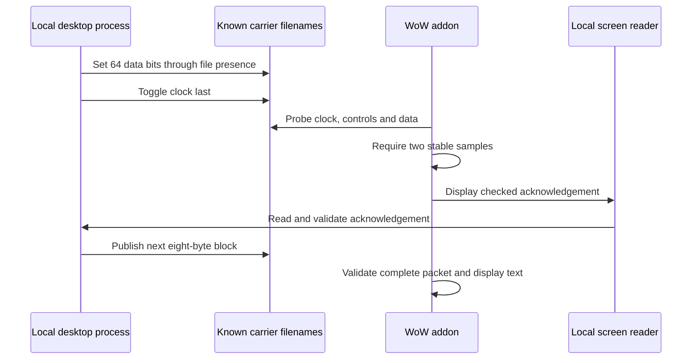

# Sending text into WoW through a sound API

*Wisp transport experiments, 6 November 2026. Article prepared 7 November 2026.*

We were building a personal companion for World of Warcraft: Forever. Players would ask a question in an addon window, a desktop process would call an AI model, and the answer would appear back in the same window while they kept playing.

Getting the question out was manageable: the addon could draw an encoded message on screen, and our desktop process could read it with local OCR. Getting text back into the addon was harder.

The result of our experiments is a small, reusable return channel built around `PlaySoundFile`. The desktop process changes whether a set of known files exists. Lua observes those changes through the sound API's return value and reconstructs bytes, checks a packet, and displays ordinary text.

No sound carries the message. The observable signal is file presence.

An initial block implementation delivered a 257-byte UTF-8 message in about 15 seconds in the running Mac client. That is slow for a conversation, but it demonstrates something useful: the same finite set of filenames can carry different messages repeatedly, without spending a new addon inbox or font filename on each message.

The original transport code is available under the repository's [MIT license](../LICENSE). This article describes the measured experiment and its ancestry; it does not claim a first-ever discovery or a production-ready bridge.

## Why the return path is difficult

Ordinary addon Lua does not have a general-purpose filesystem reader or a localhost HTTP client. SavedVariables provide persistence when the game saves, rather than an immediate bidirectional conversation channel.

Other projects have found ways around parts of that boundary. [wow-ai](https://github.com/chelinho139/wow-ai/blob/60165ca5bb6c6452f18604dc7b4fe8678b607bed/docs/ARCHITECTURE.md) draws outbound messages as colored pixels and returns replies through preinstalled, load-on-demand addon slots. That avoids a reload for each normal exchange, but each slot is loaded once during the UI lifetime.

We independently verified a similar inbox mechanism before building this channel. It worked, but it left an uncomfortable product constraint: how many replies could a player receive before the pool ran out?

Another approach, [Forever Bridge](https://github.com/0xInuarashi/wow-forever-codex/tree/85953dbecbc2e8f766e3264d3f4ea1b01cfbe2f8), encodes return bytes in font metrics. Lua measures glyph widths to recover data from previously unused font files. Its documented design uses a large, finite filename bank.

These are working ideas worth understanding. Our question was narrower: could a small set of resources carry changing data repeatedly during one uninterrupted session?

## The clue was already a doorbell

[NeverQuestAlone's signal implementation](https://github.com/tommygeoco/neverquestalone/blob/5eb98d5c33ad0c294144d5d1b0962a9fd2a70e07/bridge/transport/signals.mjs) supplied the important lead. It briefly removes and recreates an already known file. The addon probes it through `PlaySoundFile`, using the change as a doorbell that announces an update. Its [documented protocol](https://github.com/tommygeoco/neverquestalone/blob/5eb98d5c33ad0c294144d5d1b0962a9fd2a70e07/docs/PROTOCOL.md) still delivers reply contents through a finite pool of addon slots.

An earlier public report is also directly relevant: [rdimascio's pull request to wow-ai, opened 28 September 2026](https://github.com/chelinho139/wow-ai/pull/15), already records missing files returning nil and empty, garbage, truncated and valid files returning true on Mac. Its patch changes signal files to use presence rather than playable contents. This observation predates our experiments and deserves explicit credit alongside NeverQuestAlone.

That distinction matters. Reusing a notification does not automatically make the payload reusable.

We built our own probe on a Mac running Forever 1.60.1.70790, Interface 16001. In that client, an existing empty file returned a truthy first result from `PlaySoundFile`; a missing control file did not. Our own existing Lua and TOC test files also returned truthy results. The return value could therefore not be interpreted as proof that a file contained playable audio.

An external process then toggled one known file through ten absent/present cycles. Lua observed all twenty transitions without a reload or client restart.

The reusable doorbell was real on this build. We had not invented that primitive. Our next step was to use several such signals to carry the message itself.

## From one doorbell to eight bytes

A known filename can represent one bit:

- Present: `1`.
- Absent: `0`.

Eight filenames can represent a byte. Sixty-four can represent eight bytes. A separate filename acts as an alternating clock bit: its transition tells Lua that a new block is ready.



The sender sets the data first and changes the clock last. It then leaves the entire block unchanged until it receives a matching acknowledgement. Lua requires two identical samples, nominally 50 milliseconds apart, before accepting a block.

Acknowledgements travel in the other direction as visible, checksummed text read by local OCR. They identify the transfer, character binding, block sequence, received length and prefix checksum. An old acknowledgement cannot simply advance a new transfer.

Changing many filenames is not an atomic operation. Publishing in order, sampling twice and waiting for acknowledgement make this experiment controllable; they do not turn the filesystem into an atomic bus. Tests under heavier scheduling and filesystem pressure remain necessary.

## Text arrives as data

The block experiment uses a small binary frame:

```text
WB | version | transfer nonce | character binding | payload length
   | UTF-8 payload | Adler-32 | zero padding to an eight-byte boundary
```

Lua checks the frame, transfer identity, length, checksum and padding before displaying the message. A deliberately corrupted checksum was rejected, as was a packet carrying the wrong transfer nonce.

Replies are decoded as data. The receiver does not evaluate model-generated Lua or execute the answer as a command.

These checks detect accidental corruption and stale or mismatched packets. They are not cryptographic authentication against another local program or addon. The character binding is a correlation check, not proof of identity.

## What we measured

The following tests ran in the same native Mac client session. No reload, logout or client restart was used to deliver the messages. The timed block tests made no AI or network calls.

| Test | Payload | Wire size | Measured transport time | Result |
|---|---:|---:|---:|---|
| Byte-at-a-time reference, `Again` | 5 bytes | 12 bytes | 5,329.9 ms | Delivered |
| Final block version, `Again` | 5 bytes | 24 bytes | 1,438.7 ms | Delivered |
| Longer text, including åäö | 257 bytes | 272 bytes | 14,977.4 ms | Delivered |
| Deliberately damaged checksum | 3 bytes | 24 bytes | 1,336.9 ms | Rejected |
| Wrong transfer nonce | 3 bytes | First block | 423.9 ms | Rejected |

Timing starts at the first published block and ends when the sender reads the checked final acknowledgement. It excludes setup, OCR warm-up and AI generation. These are individual runs, not latency percentiles.

The final short block run was about 3.7 times faster than the newly measured byte-at-a-time reference. The longer run delivered about 17.16 payload bytes per second. Requiring an OCR round trip for every block is an obvious place to investigate, but we have not established how much of the delay each component contributes.

During the longer run, Lua reported 6,019 probes, 190.3 milliseconds of accumulated instrumented callback work and a maximum callback duration of 1.75 milliseconds. The displayed frame rate stayed at its 60 FPS cap in this short, stationary test. That does not establish performance during combat or on other hardware, and it excludes the desktop capture process's cost.

The [full experiment record](return-block-slice-2026-11-06.md) includes failures, implementation corrections and measurement boundaries.

## The underlying communication principle is older than WoW

In [A Note on the Confinement Problem](https://www.microsoft.com/en-us/research/wp-content/uploads/2016/02/acrobat-24.pdf), published in 1973, Butler Lampson describes using file interlocks as observable Boolean state. His example 5 sends a bit stream with data, send-clock and receive-clock files. Those interlock and timing examples are credited in the paper to A. G. Fraser.

That is a different mechanism from probing presence through a game's sound API, but the general idea of constructing an acknowledged channel from shared observable resource state is well established. Neither bit encoding, clocking nor acknowledgement is a new communication principle introduced by Wisp.

## What is different about this experiment

The screen channel is established territory. So are live game context, external AI companions, load-on-demand inboxes, and using sound-resource behavior to signal that something is ready.

Our implementation applies that established communication pattern to repeatedly observable file presence through WoW Forever's sound API, with checked blocks and local OCR acknowledgements. The same 64 data filenames carry successive blocks and subsequent messages. A new filename is not consumed per block or answer.

In the reviewed revisions, NeverQuestAlone uses presence signals as notifications while reply contents arrive through slots; wow-ai also uses slots, and Forever Bridge uses font metrics. We did not find the same complete presence-based payload implementation in those comparisons. This is an implementation distinction, not a claim that the general technique is new or that Wisp is the first to apply it in WoW. See the [dated prior-work audit](transport-prior-work-audit-2026-11-07.md) for scope and remaining gaps. In particular, credit for the reusable file-presence signal belongs in the explanation: reviewing NeverQuestAlone led us to the probe that made this work possible.

## What an open-source release needs

The experimental receiver and sender are first-party code: [Lua receiver](../apps/bridge-lab/return-block-bus.lua), [Python sender](../scripts/experiments/return_bus/block.py), [carrier handling](../scripts/experiments/return_bus/bus.py), and [reproduction notes](../scripts/experiments/return_bus/README.md). Their tests cover framing, UTF-8, acknowledgements, rejection and file restoration. Screen capture and OCR use Apple's platform frameworks.

Our live experiment temporarily borrowed our own already registered lab files as presence carriers. Their contents were preserved and restored; they were not read as incoming addon code. The receiver was bootstrapped once through an unused, preinstalled addon slot. Subsequent test messages used the same running receiver and reusable carriers.

A distributable implementation needs dedicated carrier files installed before the client discovers them, a minimal reproduction package, and recovery that preserves originals after interruption. It also needs testing on Windows, different client builds, sound settings, character changes and long sessions. The current result should not be described as unlimited or universally portable.

The experiment used no game-process memory reading, injection or automated gameplay. That technical scope is not Blizzard approval. The observed resource behavior is an empirical property of the tested client, not a supported IPC contract.

We set out to bring an AI reply back into a Lua window. The useful finding was smaller and more general: a sound API exposed a changing yes-or-no observation, and repeated observations were enough to reconstruct text. Whether that can become a fast, durable companion transport is the next engineering question.
